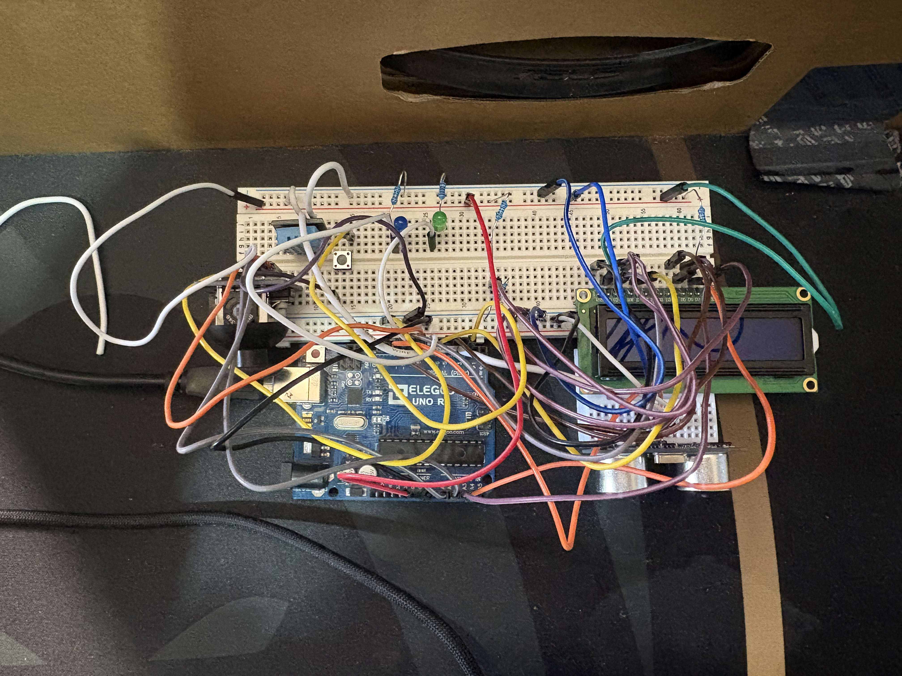
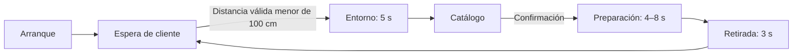

# Práctica 3 de SETR: controlador de una máquina expendedora

Se ha desarrollado una máquina expendedora con Arduino UNO que combina detección de presencia, selección de productos y supervisión desde un menú de Administración. El diseño se ha organizado mediante estados, tareas periódicas e interrupciones para mantener la interacción durante la preparación de las bebidas.

## 1. Infraestructura y montaje

Se han utilizado los componentes del kit: Arduino UNO, LCD paralelo de 16 × 2, joystick, DHT11, sensor de ultrasonidos, pulsador externo y dos LEDs. El montaje se ha realizado sobre protoboard, con masa común y resistencias limitadoras para los LEDs.

### Montaje real

### Esquema orientativo

El esquema se ha empleado como apoyo al diseño y **no reproduce exactamente los componentes ni todas las conexiones finales**. La asignación de señales utilizada es la siguiente:

| Elemento | Conexiones |
|---|---|
| Joystick | X: A0; Y: A1; pulsador: D8 |
| Pulsador externo | D2, con interrupción hardware |
| Ultrasonidos | TRIG: D11; ECHO: D3, con interrupción hardware |
| DHT11 | Datos: D4 |
| LEDs | LED1: D7; LED2: D9, con PWM |
| LCD | RS: D10; Enable: D6; datos D4–D7 del LCD: D5, D12, A2 y A3 |

Se han reservado D2 y D3 para las interrupciones externas del UNO. Para liberar D3 para ECHO, se ha trasladado una señal del LCD a D12. El LED2 se ha conectado a un pin PWM para representar el progreso mediante su brillo. Ambos pulsadores utilizan resistencias internas de pull-up y lógica activa en LOW.

## 2. Arquitectura por estados

Se ha decidido separar tres modos generales:

- **Arranque:** se muestra `CARGANDO...` y se realizan tres ciclos de un segundo encendido y otro apagado, con una duración aproximada de seis segundos.
- **Servicio:** se atiende al cliente mediante las fases de espera, presentación del entorno, catálogo, preparación y retirada.
- **Administración:** se consultan temperatura, humedad, distancia y tiempo desde el encendido, y se modifican los precios.

Se han centralizado las entradas a los modos y los cambios de fase para reiniciar únicamente los datos de cada operación. Entrar en Administración abandona la compra en curso; salir devuelve el sistema a espera. Los precios confirmados se conservan en ambos casos.

Los tiempos se calculan a partir del instante de entrada a cada fase. Se ha evitado representar los segundos de espera mediante retardos bloqueantes, de modo que puedan seguir atendiéndose botones y sensores.

## 3. Reparto del trabajo y recursos utilizados

Se ha utilizado **ArduinoThread** para organizar las tareas periódicas dentro de un único controlador:

| Tarea | Intervalo | Finalidad |
|---|---|---|
| Joystick | 20 ms | Leer movimientos y pulsaciones |
| Solicitud del DHT11 | 2000 ms | Programar una lectura de temperatura y humedad |
| Progreso del LED2 | 20 ms | Actualizar el brillo durante la preparación |
| LCD | 200 ms | Actualizar la información visible |

La planificación es cooperativa: las tareas se ejecutan sucesivamente, sin paralelismo real. Se ha mantenido una llamada por función en cada vuelta del programa para simplificar su organización.

La gestión del ultrasonidos tiene prioridad antes de ejecutar las tareas, para terminar el pulso corto de disparo sin alargarlo con una escritura del LCD. Después se atienden las entradas, los estados y las salidas. Esta estructura combina trabajo periódico con atención continua a los eventos capturados por interrupción.

Se han empleado LiquidCrystal para el LCD y la librería DHT de Adafruit para el sensor ambiental. No se ha añadido TimerOne: la temporización se resuelve con las marcas de tiempo y las interrupciones disponibles.

## 4. Entradas y coordinación de sensores

### Joystick y botón externo

Se ha calibrado la orientación del joystick sobre el montaje real y se ha establecido una zona central para evitar movimientos provocados por pequeñas variaciones. Cada inclinación genera una acción y exige regresar al centro antes de aceptar otra. La navegación se detiene en los extremos de las listas.

Se ha aplicado un antirrebote de 30 ms a los pulsadores. Las confirmaciones se tratan como eventos nuevos, evitando repeticiones al mantener un botón pulsado.

El botón externo utiliza una interrupción que captura el nivel y el instante del cambio. Su interpretación se realiza en el flujo principal:

- **Entre dos y tres segundos:** se cancela al soltar y se vuelve a espera desde las fases de interacción de Servicio.
- **Al alcanzar cinco segundos:** se entra o sale de Administración.

Se ha decidido confirmar la cancelación al soltar para que una pulsación larga no cancele primero y abra Administración después. Cada pulsación solo puede producir una acción; para salir de Administración es necesario soltar y volver a pulsar.

### Distancia y entorno

Se ha utilizado una segunda interrupción para capturar la subida y bajada de ECHO. Así se obtiene la duración del eco sin detener el programa esperando su llegada. Se intenta medir cada 60 ms y se descarta la medición si no se completa en 30 ms. Una respuesta ausente o inválida se muestra como `SIN DATOS`, en lugar de interpretarse como distancia cero.

Las interrupciones se mantienen breves. Los datos compartidos se recogen mediante secciones críticas cortas, dejando los cálculos y la actualización de pantallas fuera de ellas.

Para el DHT11 se ha elegido una lectura cada dos segundos. Si coincide con una medición de distancia, se conserva la solicitud pendiente y se atiende al terminar el eco, antes de otro disparo. Esta separación evita que la lectura síncrona del DHT interfiera con la captura de ECHO. Las pantallas muestran los datos almacenados, sin iniciar nuevas lecturas en cada refresco.

## 5. Preparación, precios y presentación

Se ha elegido una duración pseudoaleatoria entre cuatro y ocho segundos al confirmar cada bebida. Se utiliza únicamente `random()`.

El brillo del LED2 se calcula proporcionalmente al tiempo transcurrido, en lugar de aumentarlo por pasos fijos. Así el progreso depende de la duración de la bebida y no del número de ejecuciones de la tarea. Al terminar, se mantiene el brillo máximo durante los tres segundos de retirada.

Se ha centralizado el control de los LEDs para evitar que distintas tareas impongan estados contradictorios. En Administración ambos permanecen encendidos; en Servicio están apagados salvo el LED2 durante preparación y retirada.

Los precios se almacenan como **céntimos enteros** para evitar errores de redondeo al modificarlos. La edición se realiza sobre un borrador, en incrementos o decrementos de cinco céntimos, con límites para impedir valores negativos y desbordamientos. Confirmar guarda el nuevo importe; izquierda o salir de Administración descarta los cambios pendientes. Los precios confirmados se comparten con Servicio y permanecen en RAM hasta apagar o reiniciar, sin utilizar EEPROM.

Se ha adaptado la presentación al LCD de dos filas: se muestra una opción cada vez y se reparten los mensajes largos. Se utilizan textos como `Cafe`, `C` y `EUR` para evitar depender de caracteres especiales. Se conserva un refresco periódico de 200 ms y se sobrescriben con espacios los restos de textos anteriores.

## 6. Recuperación y comprobaciones

Se ha configurado un **watchdog de dos segundos**, refrescado al completar una vuelta del programa. El plazo controla que el flujo principal siga avanzando; una preparación de ocho segundos no lo agota porque se siguen ejecutando las demás tareas. Se ha evitado refrescarlo desde una interrupción que pudiera ocultar un bloqueo.

Durante el desarrollo se han comprobado las lecturas de sensores y la edición de precios, incluyendo confirmación, descarte y visualización posterior en Servicio. También se ha observado que un objeto demasiado próximo al ultrasonidos puede producir una medida inválida.

La recuperación ante un bloqueo deliberado del programa queda pendiente de validar en la placa. La revisión conjunta debe comprobar además la compra completa, las cancelaciones y el acceso a Administración desde las distintas fases. La planificación cooperativa y el coste síncrono del DHT y del LCD deben tenerse en cuenta al evaluar la respuesta del sistema.

## 7. Referencias y entrega

Se ha utilizado la teoría proporcionada de SETR sobre programación Arduino, multitarea e interrupciones, junto con sus referencias autorizadas:

- [LiquidCrystal: ejemplo HelloWorld](https://github.com/arduino-libraries/LiquidCrystal/blob/master/examples/HelloWorld/HelloWorld.ino).
- [Adafruit DHT: ejemplo DHTtester](https://github.com/adafruit/DHT-sensor-library/blob/master/examples/DHTtester/DHTtester.ino).
- [ArduinoThread](https://github.com/ivanseidel/ArduinoThread).
- [Referencia oficial de random](https://github.com/arduino/reference-en/blob/master/Language/Functions/Random%20Numbers/random.adoc).
